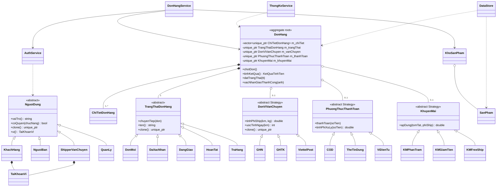
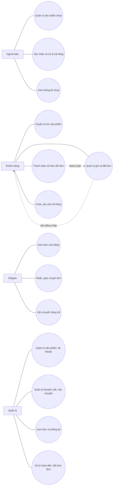
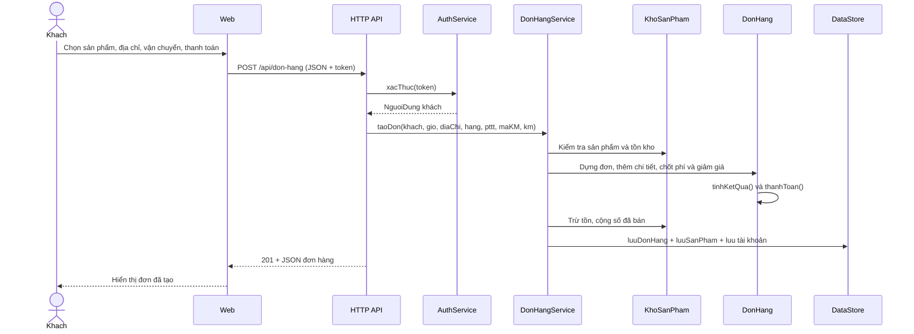
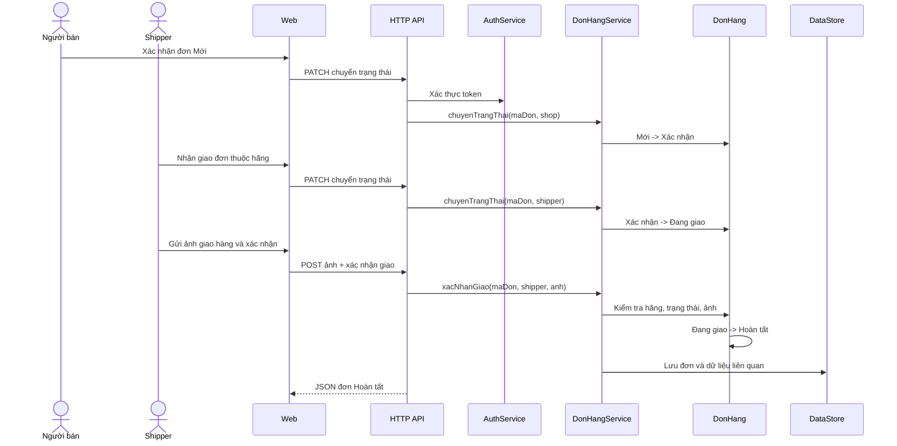

# Sơ đồ UML

Các sơ đồ dùng cú pháp Mermaid có thể sửa trực tiếp và xem trong GitHub/VS Code với Mermaid preview. Quan hệ được đối chiếu với `include/*.h`, `src/DonHangService.cpp` và `docs/KIEN_TRUC.md`.

## Class diagram

## Use case

## Sequence 1: đặt hàng

## Sequence 2: giao hàng có ảnh

